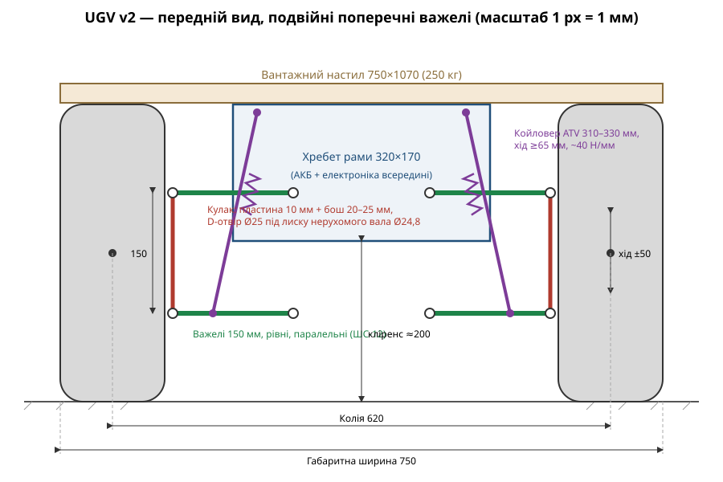
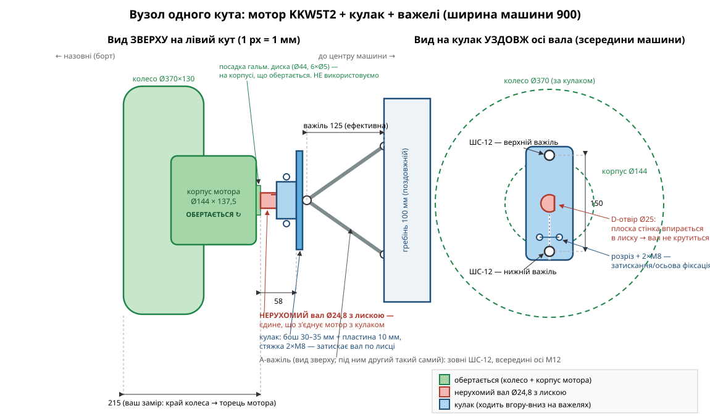
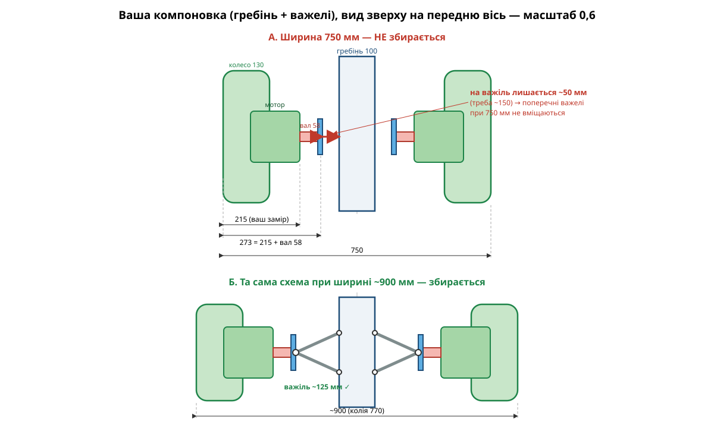

# UGV v2 — незалежна підвіска на кожне колесо

Конструкторський документ для другої версії платформи. Мета — додати незалежну
підвіску на кожне з 4 коліс за схемою, як на зразку (подвійні поперечні важелі
з винесеними койловерами), зберігши габарити та корисне навантаження v1.

---

## 1. Вхідні дані

### 1.1. Вимоги (від замовника)

| Параметр | Значення | Примітка |
|---|---|---|
| Довжина | 1070 мм | можна трохи змінити |
| Ширина | **900 мм** | v1 була 750; розширення погоджено, бо при 750 мм поперечні важелі з моторами KKW5T2 фізично не вміщаються (див. [`layout-options.svg`](layout-options.svg)) |
| Корисне навантаження | 250 кг | |
| Мотори | KKW5T2 × 4 | мотор-редуктор у ступиці |

### 1.2. Заміри з фото v1

| Параметр | Значення | Джерело |
|---|---|---|
| Зовнішній діаметр колеса | ≈ 370 мм | рулетка впоперек колеса (3→40 см) |
| Ширина колеса (по ґрунтозачепах) | ≈ 125–130 мм | рулетка по протектору |
| Колісна база (вісь-вісь) | ≈ 660–680 мм | рулетка через два колеса |
| Кріплення колеса | 4 шпильки, PCD ≈ 100 мм | збігається з фланцем мотора |
| Від зовн. краю колеса до торця мотора (посадка гальм. диска) | **215 мм** | фланець колеса стоїть посередині колеса, мотор іде вглиб машини |
| Від зовн. краю колеса до кінця нерухомого вала | **273 мм** | 215 + вал 58 |

### 1.3. Мотор KKW5T2 (з креслення)

| Параметр | Значення |
|---|---|
| Крутний момент | 200 Н·м (перевірити: піковий чи тривалий) |
| Маса | 8 кг |
| Довжина корпусу | 137,5 мм, Ø корпусу ≈ 144 мм |
| Вихідний фланець (колесо) | Ø125, 4 отв. Ø14 на PCD 101,6 (варіант PCD 100) |
| **Нерухомий вал (кріплення до UGV)** | **Ø24,8 мм, виступ 58 мм, з лискою** проти прокручування |
| Посадка гальмівного диска (НЕ використовується) | Ø33 / Ø44, 6 отв. Ø5 — на корпусі, що **обертається** |

**Ключовий момент для підвіски:** вал Ø24,8 закріплений нерухомо, корпус
мотора разом із колесом обертається навколо нього. Увесь реактивний момент
200 Н·м і вся вага кута машини передаються на кулак **тільки через цей вал**:
момент — через лиску, вертикальні/бічні сили — консольно через виступ 58 мм.
Отвори 6×Ø5 на Ø44 чіпати не можна — вони на обертовій частині (під гальмівний
диск). Тому кулак — це по суті затискач вала з D-подібним отвором під лиску,
і довжина затиснення має бути максимальною (див. §4.3): одна тонка пластина
дасть завеликий тиск на лиску і розіб'є посадку.

---

## 2. Масовий баланс і навантаження

Оцінка споряджених мас (уточнити зважуванням v1):

| Вузол | Маса |
|---|---|
| Мотори 4 × 8 кг | 32 кг |
| Колеса 4 × ~5 кг | 20 кг |
| Рама + настил | ~35 кг |
| АКБ | ~15 кг |
| Підвіска (важелі, кулаки, амортизатори) | ~12 кг |
| Електроніка, корпус, кабелі | ~6 кг |
| **Споряджена маса** | **~120 кг** |
| Корисне навантаження | 250 кг |
| **Повна маса (GVW)** | **~370 кг** |

Навантаження на кут (при рівномірному розподілі):

| Величина | Значення |
|---|---|
| Статичне на колесо (повна маса) | 92,5 кг ≈ **910 Н** |
| Непідресорена маса на кут (мотор 8 + колесо 5 + кулак/частка важелів ~4) | ~17 кг |
| Підресорена маса на кут, завантажений | ~75 кг |
| Підресорена маса на кут, порожній | ~13 кг |
| Розрахункове динамічне (3g на один кут, удар) | ≈ **2,7 кН** |

> Співвідношення порожній/завантажений дуже велике (120 ↔ 370 кг) — це головна
> складність підвіски цієї машини, див. §5.

---

## 3. Вибір схеми підвіски

### Варіант А — подвійні поперечні важелі (як на зразку) ✅ рекомендовано

- **+** Схема зі зразка; бічні сили (а їх при бортовому розвороті багато) сприймаються важелями «в розтяг/стиск» — найжорсткіший напрямок.
- **+** Рівні паралельні важелі → розвал не змінюється на всьому ході.
- **+** Амортизатор виноситься до рами, легко обслуговувати.
- **−** З моторами KKW5T2 (виліт 273 мм на борт) потребує ширини ~900 мм:
  при 750 мм на важіль лишається ~50 мм (див. [`layout-options.svg`](layout-options.svg)).
- **−** Більше деталей: 8 важелів, 16 шарнірів.

### Варіант Б — поздовжній важіль (trailing arm)

- **+** Найпростіший: 4 важелі, рама може лишатись повної ширини, колія не змінюється.
- **−** Бічні сили при бортовому розвороті працюють на скручування важеля і сайлентблоків — потрібна широка база втулок.
- **−** Переднє колесо «б'є» вперед у перешкоду жорсткіше (вісь гойдання поперечна).

**Рішення (погоджено):** варіант А, рівні паралельні А-подібні важелі,
габаритна ширина збільшується до **900 мм**. Компоновка — за ескізом
замовника: поздовжній гребінь на передній осі, до нього з бортів колеса на
важелях, далі центральний корпус, ззаду — другий такий самий гребінь.
Оскільки машина бортоповоротна і коліс, що повертаються, нема — кулак
гранично простий (пластина-затискач без осі повороту), і головний недолік
коротких важелів (зміна розвалу) знімається рівними паралельними важелями.

---

## 4. Геометрія (варіант А)

### 4.1. Загальні розміри v2

| Параметр | Значення | Коментар |
|---|---|---|
| Габаритна ширина | **900 мм** | розширено з 750 |
| Колія (центр–центр колеса) | **770 мм** | 900 − 130; ширша колія = краща стійкість із вантажем 250 кг |
| Колісна база | **680 мм** | як v1; можна 700 при подовженні рами |
| Габаритна довжина | 1070 мм (вантажний настил зверху, повна ширина) | |
| Зайнято мотором+валом на борт | 273 мм від зовн. краю колеса | кулак стоїть на кінці вала, за 177 мм від поздовжньої осі машини |
| Гребінь осі (передній і задній) | **ширина 100 мм** | поздовжній короб, до нього кріпляться важелі |
| Хід підвіски | **100 мм** (50 відбій / 50 стиск у завантаженому стані) | |
| Кліренс під гребенем/корпусом (завантажений) | ~200 мм | |

### 4.2. Важелі

| Параметр | Значення |
|---|---|
| Ефективна довжина важеля (вісь гойдання → сферичний шарнір) | **125 мм** |
| Верхній важіль = нижній (рівні, паралельні) | так |
| Вертикальна відстань між кульовими точками кулака | **150 мм** |
| Кут гойдання при повному ході ±50 мм | ±23,6° |
| Зміна колії на один борт при повному ході | ≈ 10 мм (прийнятно для бортоповоротної) |
| Розвал/сходження | 0°, не змінюються (рівні паралельні важелі) |

Матеріал важелів: А-подібні, труба **25×25×2** (або Ø25×2,5) Ст3/09Г2С,
база внутрішніх шарнірів одного важеля ≥ 180 мм уздовж рами.

Шарніри:
- Зовнішні (до кулака): сферичні шарніри **M12** (рід-енди / ШС-12), 8 шт.
- Внутрішні (до гребеня): болт M12 + поліуретанові втулки або теж ШС, 16 точок.
- Осі всіх болтів шарнірів — **уздовж машини**: тоді хитання важеля ±23,6° —
  це вільне обертання навколо болта, а не викручування кульки на перекос.

### 4.3. Кулак (upright) — затискач нерухомого вала Ø24,8

Вал має лише 58 мм виступу, тому використати його треба повністю:

- **Основа:** пластина 10 мм + приварений **бош (бобишка) завтовшки 20–25 мм**
  (або пакет 2–3 пластин 10 мм), разом **30–35 мм довжини затиснення** вала —
  решта 58 мм лишається на зазор до корпусу мотора і шайбу/стопор.
- **Отвір:** D-подібний (або під дві лиски — за фактичним профілем вала):
  Ø25 H8 + пряма стінка по лисці. Момент 200 Н·м передається **тільки лискою**,
  тому посадка по лисці — без люфту (різати лазером/фрезою, не «болгаркою»).
- **Фіксація від осьового зміщення:** розрізний затискач з 2 болтами M8 поперек
  боша, або притискна пластина зовні + штатна гайка вала (якщо кінець вала
  різьбовий — уточнити по мотору).
- Вуха під верхній/нижній сферичний шарнір, міжцентрова відстань 150 мм.
- Колесо лишається на штатних 4 шпильках фланця мотора PCD 100/101,6.
- Отвори Ø5 на Ø44 **не використовувати** — це обертова частина (посадка
  гальмівного диска).

### 4.4. Амортизатор

Важіль короткий (125 мм), тому нижнє кріплення амортизатора — на нижньому
важелі **впритул до кульового шарніра** (це також розвантажує важіль від
згину пружиною); верхнє — на стійці гребеня; нахил від вертикалі ~20°.
Амортизатор проходить повз верхній важіль — змістити його вперед/назад
відносно площини важеля на 30–40 мм.

- Передавальне число (motion ratio) ≈ **0,9**
- Хід штока: ≥ 100 × 0,9 = **90 мм** (брати 90–110 мм)
- Монтажна довжина «вухо-вухо» ≈ **360–400 мм** (підібрати під фактичну висоту стійки)

---

## 5. Розрахунок пружності

Цільова власна частота підресореної маси у завантаженому стані ~2,2 Гц
(вантажна позашляхова платформа без людей).

| Крок | Формула | Результат |
|---|---|---|
| Жорсткість на колесі | k = m·(2πf)² = 75 кг × (2π·2,2)² | **≈ 14,5 Н/мм** |
| Жорсткість пружини | k / MR² = 14,5 / 0,9² | **≈ 18 Н/мм (≈ 105 lb/in)** |
| Статичний прогин, завантажений | 740 Н / 14,5 | ≈ 50 мм (= весь хід відбою → виставити переднатягом) |
| Статичний прогин, порожній | 130 Н / 14,5 | ≈ 9 мм |
| Сила на амортизаторі, статика завантажений | 740 / 0,9 | ≈ 0,82 кН |
| Сила на амортизаторі, удар 3g | | ≈ 2,5 кН — перевірити кронштейни |

**Готове рішення:** 4 койловери від ATV/квадроцикла, довжина ~360–400 мм,
хід 90–110 мм, пружина 17–20 Н/мм (95–115 lb/in), з регулюванням переднатягу.
Якщо доступні лише жорсткіші пружини (типово для ATV 150+ lb/in) — брати
койловер коротший ходом і ставити далі від кульової (менший MR), перерахувавши
MR² під наявну пружину.

**Проблема «порожній/завантажений»:** з пружиною під повну масу порожня машина
стоятиме майже на відбої (прогин ~9 мм) і їхатиме жорстко (~5 Гц). Варіанти:
1. Прийняти як є (вантажна платформа — найпростіше). ✅
2. Двоступеневі (dual-rate) пружини — м'яка секція працює порожнім.
3. Переналаштування переднатягу під місію (ключем, 1 хв на колесо).

---

## 6. Перевірочні розрахунки

| Перевірка | Розрахунок | Висновок |
|---|---|---|
| Тяга на колесі | 200 Н·м / 0,185 м = 1,08 кН; разом 4,3 кН | > ваги 3,6 кН → обмежена зчепленням, не моментом. Підйоми 30°+ по зчепленню |
| Бічна сила при розвороті (μ≈0,8) | ~0,73 кН на пляму контакту | Пара на шарнірах кулака: 0,73×185/150 ≈ 0,9 кН — ШС-12 (статична ≥ 20 кН) із великим запасом |
| Удар 3g на кут | 2,7 кН на колесі | Важіль 25×25×2 на стиск/вигин — запас > 3; на стійку амортизатора приходить ~3 кН → косинки на кронштейнах обов'язково |
| Вигин вала Ø24,8 (консоль) | площина колеса за ~180 мм від затискача (фланець посередині колеса!) → при ударі 2,7 кН M ≈ 480 Н·м; W = πd³/32 ≈ 1,5 см³ → σ ≈ 320 МПа | Запас малий — це вузьке місце самого мотора (v1 живе з тією ж консоллю, а підвіска удари ще й зменшить). Обов'язково: затискати вал усіма 30–35 мм, впритул до корпусу мотора, без проставок |
| Тиск на лиску вала | 200 Н·м / ~11 мм ≈ 18 кН на площину лиски | З довжиною затиснення 30–35 мм — у нормі; одна пластина 10 мм дає ~3× більший тиск і розіб'є посадку → тільки бош/пакет пластин (§4.3) |
| Швидкість | мотор ~100–150 об/хв × πD 1,16 м | ≈ 7–10 км/год — уточнити по ВАХ мотора |

---

## 7. Зміни рами v1 → v2

Компоновка за ескізом замовника: **передній гребінь → центральний корпус →
задній гребінь**.

1. **Гребінь осі** (×2, спереду і ззаду): поздовжній короб **шириною 100 мм**
   (два профілі 50×50×3 зварені разом, або короб 100×160×3), довжина
   ~400 мм уздовж машини. На його бортах — кронштейни важелів (по 2 вуха
   на важіль, пластина 5–6 мм, база 180 мм, болти M12), зверху — стійка
   амортизатора з косинками (вузол тримає до ~3 кН).
2. **Центральний корпус** між гребенями: несучий короб шириною до ~600 мм
   (між внутрішніми краями коліс із запасом), жорстко зварений/болтований
   з обома гребенями. АКБ та електроніка — всередину, якнайнижче
   (центр мас ↓, стійкість ↑).
3. **Вантажний настил** 900×1070 мм — зверху, над колесами (як на зразку).
4. Перевірити жорсткість стику «гребінь–корпус» на кручення: весь момент
   від підвіски заходить у раму саме там → косинки/розкоси обов'язково.

---

## 8. Специфікація (BOM) на підвіску

| Поз. | Найменування | К-сть | Примітка |
|---|---|---|---|
| 1 | Койловер ATV 360–400 мм, хід 90–110 мм, пружина 17–20 Н/мм | 4 | з регулюванням переднатягу |
| 2 | Важіль А-подібний верхній (труба 25×25×2) | 4 | ефективна довжина 125 мм |
| 3 | Важіль А-подібний нижній (труба 25×25×2, з вухом амортизатора біля кульової) | 4 | |
| 4 | Сферичний шарнір ШС-12 / rod-end M12 | 8–24 | 8 зовнішніх обов'язково; внутрішні — ШС або поліуретан |
| 5 | Кулак — пластина 10 мм + бош 20–25 мм, D-отвір Ø25 під лиску вала | 4 | затиснення вала 30–35 мм |
| 6 | Кронштейни важелів (пластина 5–6 мм) | 16 | |
| 7 | Стійка амортизатора з косинками | 4 | |
| 8 | Болти M12×70 10.9, гайки самоконтрені | ~24 | осі важелів |
| 9 | Болти M8 10.9 (затискач кулака) | 8–16 | по 2–4 на кулак |

---

## 9. Схема

Файли: [`front-view.svg`](front-view.svg), [`corner-module.svg`](corner-module.svg), [`layout-options.svg`](layout-options.svg)

---

## 10. Наступні кроки

1. **Зважити v1** фактично (рама, колесо, вкажіть масу АКБ) — уточнити §2 і жорсткість пружин.
2. Уточнити у продавця KKW5T2 тривалий момент і об/хв під навантаженням; на наявному моторі обміряти профіль вала Ø24,8 (одна лиска чи дві, ширина/глибина лиски, чи є різьба під гайку на кінці) — під це ріжеться D-отвір кулака.
3. Купити 1 койловер на пробу, зняти фактичну характеристику (довжина/хід/жорсткість).
4. Зварити **один кутовий модуль** (важелі+кулак+стійка) і випробувати на стенді/на v1 перед виготовленням чотирьох.
5. Після збирання: виставити переднатяг так, щоб під повним завантаженням лишалося ~45–50 мм ходу стиску.
